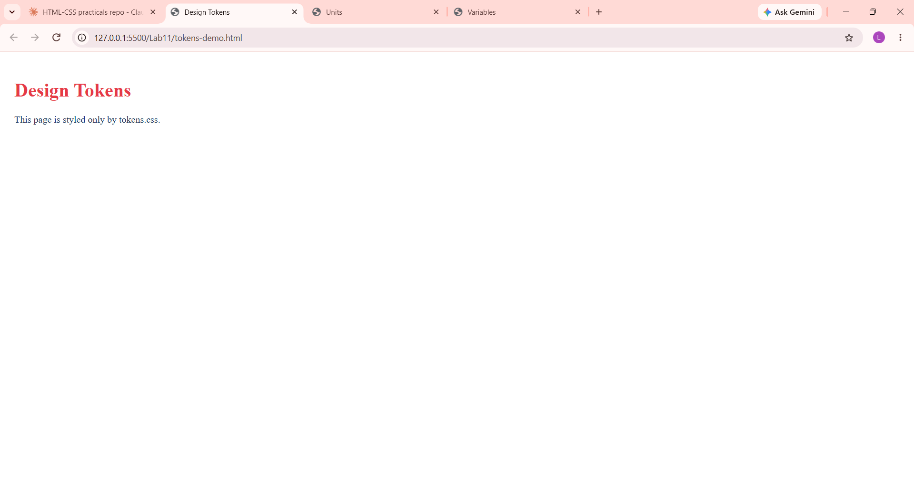

# Lab 11: Units and CSS Variables

**Course:** HTML & CSS Development Lab (BCS554) - Invertis University, Bareilly
**Name:** Priyansh Singh  |  **Roll No:** 2550303020

**Aim:** Use CSS units and store colours and spacing in variables.

## Tasks and files
| Task | File |
|------|------|
| Task 1 | `units.html` |
| Task 2 | `variables.html` |
| Task 3 | `tokens.css (used by tokens-demo.html)` |

## How to run
Open the HTML file in VS Code and use **Live Server** (or double-click the file to open it in a browser).

## Output screenshot
Add your screenshot as `images/screenshot.png`, then it will show here:

