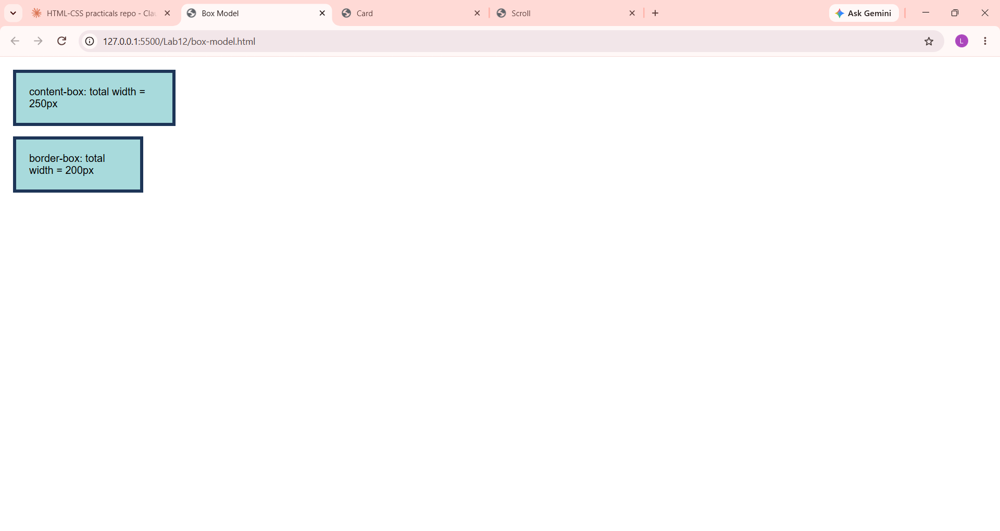

# Lab 12: Box Model, Cards and Scrolling

**Course:** HTML & CSS Development Lab (BCS554) - Invertis University, Bareilly
**Name:** Priyansh Singh  |  **Roll No:** 2550303020

**Aim:** Compare the box sizing types, style a card and make a box scroll.

## Tasks and files
| Task | File |
|------|------|
| Task 1 | `box-model.html` |
| Task 2 | `card.html` |
| Task 3 | `scroll.html` |

## How to run
Open the HTML file in VS Code and use **Live Server** (or double-click the file to open it in a browser).

## Output screenshot
Add your screenshot as `images/screenshot.png`, then it will show here:

