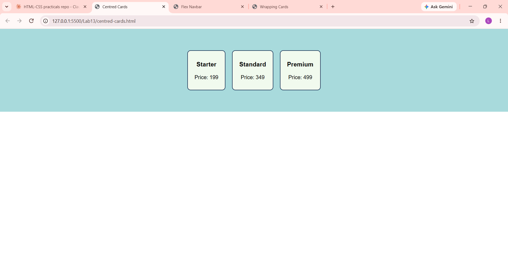

# Lab 13: Flexbox Layouts

**Course:** HTML & CSS Development Lab (BCS554) - Invertis University, Bareilly
**Name:** Priyansh Singh  |  **Roll No:** 2550303020

**Aim:** Lay out a navigation bar, centred cards and cards that wrap, using Flexbox.

## Tasks and files
| Task | File |
|------|------|
| Task 1 | `nav-flex.html` |
| Task 2 | `centred-cards.html` |
| Task 3 | `wrapping-cards.html` |

For Task 3, narrow the browser window (or press F12 -> device toolbar) to see the cards wrap.

## How to run
Open the HTML file in VS Code and use **Live Server** (or double-click the file to open it in a browser).

## Output screenshot
Add your screenshot as `images/screenshot.png`, then it will show here:

