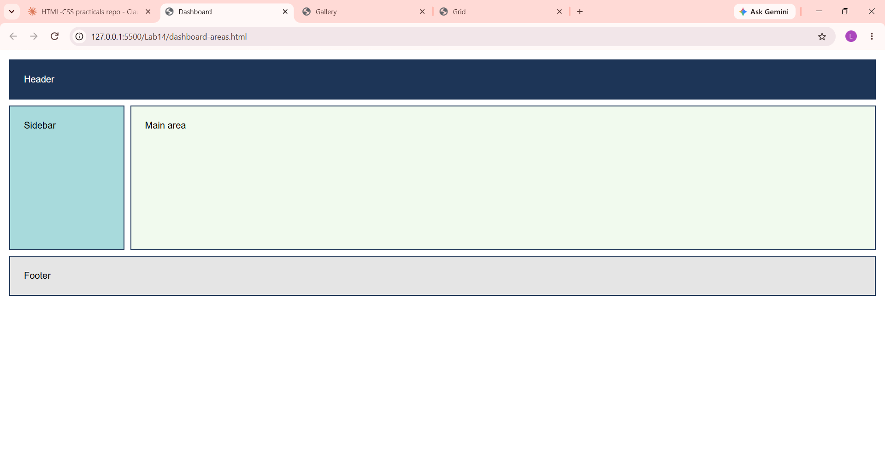

# Lab 14: CSS Grid Layouts

**Course:** HTML & CSS Development Lab (BCS554) - Invertis University, Bareilly
**Name:** Priyansh Singh  |  **Roll No:** 2550303020

**Aim:** Make a grid with equal columns, a responsive gallery and a layout with named areas.

## Tasks and files
| Task | File |
|------|------|
| Task 1 | `grid-first.html` |
| Task 2 | `gallery.html` |
| Task 3 | `dashboard-areas.html` |

## How to run
Open the HTML file in VS Code and use **Live Server** (or double-click the file to open it in a browser).

## Output screenshot
Add your screenshot as `images/screenshot.png`, then it will show here:

