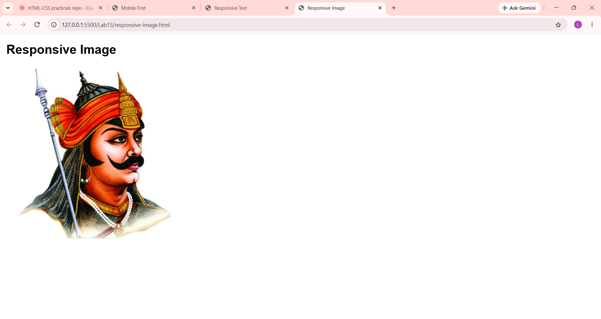

# Lab 15: Responsive Pages with Media Queries

**Course:** HTML & CSS Development Lab (BCS554) - Invertis University, Bareilly
**Name:** Priyansh Singh  |  **Roll No:** 2550303020

**Aim:** Use a media query to change a layout, make a picture scale with its box, and set text sizes with rem units.

## Tasks and files
| Task | File |
|------|------|
| Task 1 | `mobile-first.html` |
| Task 2 | `responsive-image.html` |
| Task 3 | `responsive-text.html` |

`images/photo.jpg` is a placeholder. Use the file name your instructor gives you and update the `src` in `responsive-image.html`.

## How to run
Open the HTML file in VS Code and use **Live Server** (or double-click the file to open it in a browser).

## Output screenshot
Add your screenshot as `images/screenshot.png`, then it will show here:

