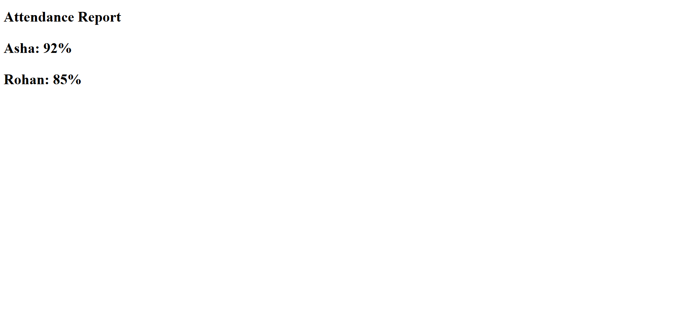

# Lab 4: Divs, Attributes and a Small Fix

**Course:** HTML & CSS Development Lab (BCS554) - Invertis University, Bareilly
**Name:** Priyansh Singh  |  **Roll No:** 2550303020

**Aim:** Group parts of a page with div elements, add a data attribute, and fix the errors in a broken page.

## Tasks and files
| Task | File |
|------|------|
| Task 1 | `layout.html` |
| Task 2 | `attributes.html` |
| Task 3 | `attendance-fixed.html` |

## Errors fixed in Task 3
1. `<h1>` was never closed -> added `</h1>`.
2. `
Asha: 92%
` used an opening `
` where the closing tag was needed -> changed to `
`.
3. (Good practice) added `lang="en"` on `<html>` and `<meta charset="UTF-8">` in `<head>`.

`attendance-broken.html` is the original broken page, kept only for comparison.

## How to run
Open the HTML file in VS Code and use **Live Server** (or double-click the file to open it in a browser).

## Output screenshot
Add your screenshot as `images/screenshot.png`, then it will show here:

