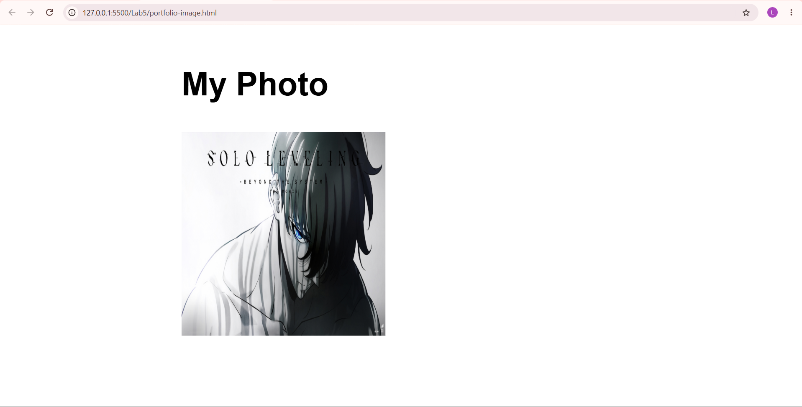

# Lab 5: Links and Images

**Course:** HTML & CSS Development Lab (BCS554) - Invertis University, Bareilly
**Name:** Priyansh Singh  |  **Roll No:** 2550303020

**Aim:** Link two pages together and add a picture with alt text.

## Tasks and files
| Task | File |
|------|------|
| Task 1 | `home.html` |
| Task 2 | `portfolio.html` |
| Task 3 | `portfolio-image.html` |

## Note about the image
`images/photo.jpg` is a placeholder picture. Your instructor will give you the real file name:
put that file in `images/` and change the `src="images/photo.jpg"` in `portfolio-image.html`.

## How to run
Open the HTML file in VS Code and use **Live Server** (or double-click the file to open it in a browser).

## Output screenshot
Add your screenshot as `images/screenshot.png`, then it will show here:

