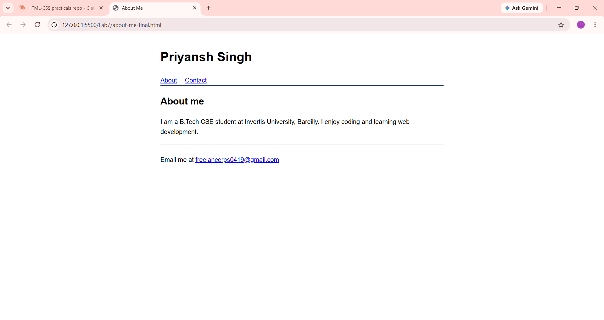

# Lab 7: About Me Page

**Course:** HTML & CSS Development Lab (BCS554) - Invertis University, Bareilly
**Name:** Priyansh Singh  |  **Roll No:** 2550303020

**Aim:** Build a short About Me page with semantic tags, an about section and a contact link.

## Tasks and files
| Task | File |
|------|------|
| Task 1 | `about-me.html` |
| Task 2 | `about-me-section.html` |
| Task 3 | `about-me-final.html` |

Task 1 -> `about-me.html`, Task 2 -> `about-me-section.html`, Task 3 -> `about-me-final.html`
(each task builds on the previous one). Replace `Priyansh Singh` and the email with your own.

## How to run
Open the HTML file in VS Code and use **Live Server** (or double-click the file to open it in a browser).

## Output screenshot
Add your screenshot as `images/screenshot.png`, then it will show here:

