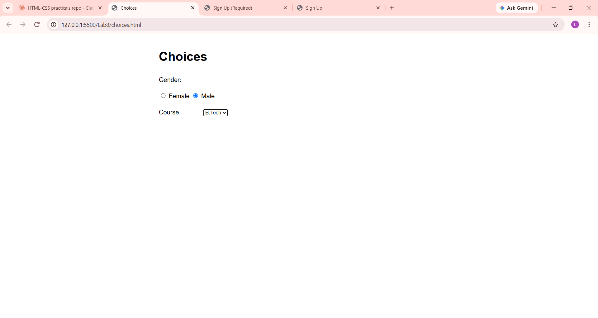

# Lab 8: Sign-Up Forms and Choices

**Course:** HTML & CSS Development Lab (BCS554) - Invertis University, Bareilly
**Name:** Priyansh Singh  |  **Roll No:** 2550303020

**Aim:** Make a labelled form with text, email and password fields, choices and a submit button.

## Tasks and files
| Task | File |
|------|------|
| Task 1 | `signup.html` |
| Task 2 | `choices.html` |
| Task 3 | `signup-required.html` |

## How to run
Open the HTML file in VS Code and use **Live Server** (or double-click the file to open it in a browser).

## Output screenshot
Add your screenshot as `images/screenshot.png`, then it will show here:

