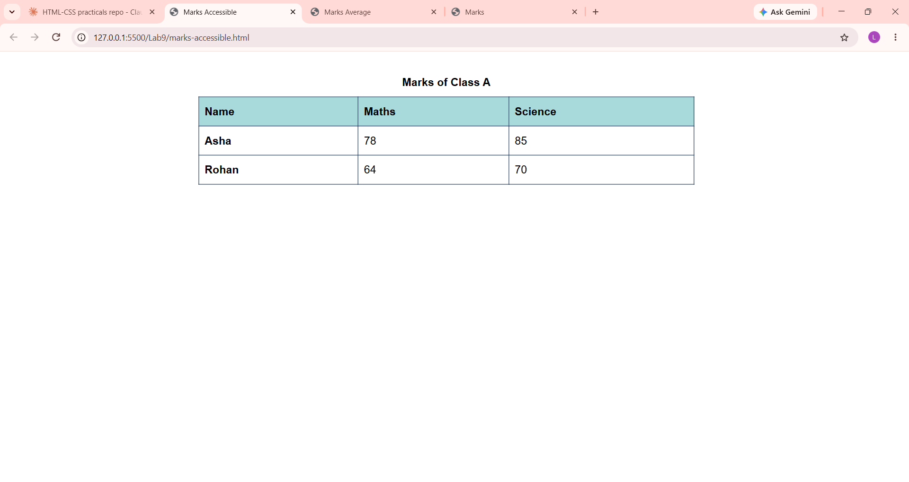

# Lab 9: Tables with Headers and Footers

**Course:** HTML & CSS Development Lab (BCS554) - Invertis University, Bareilly
**Name:** Priyansh Singh  |  **Roll No:** 2550303020

**Aim:** Build a table with a caption, a header, rows and a footer, and add scope attributes.

## Tasks and files
| Task | File |
|------|------|
| Task 1 | `marks.html` |
| Task 2 | `marks-average.html` |
| Task 3 | `marks-accessible.html` |

Averages: Maths = (78 + 64) / 2 = **71**, Science = (85 + 70) / 2 = **77.5**.

## How to run
Open the HTML file in VS Code and use **Live Server** (or double-click the file to open it in a browser).

## Output screenshot
Add your screenshot as `images/screenshot.png`, then it will show here:

